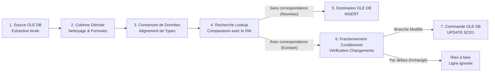
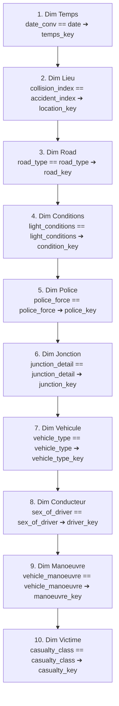

# Manuel & Guide d'Architecture Technique Décisionnelle Ultra-Détaillé
## Système Décisionnel pour la Sécurité Routière (UK STATS19)
**Projet Data Warehouse & Business Intelligence – ESPRIT 2026**  
**Auteurs :** Équipe Projet BI & Data Engineering ESPRIT  
**Technologies :** Microsoft SQL Server (SSMS), SQL Server Integration Services (SSIS), SSDT / Visual Studio, T-SQL  

---

## 📌 Sommaire Général
1. [Vue d'Ensemble & Rôle Général de Chaque Composant SSIS (Balise)](#1-vue-densemble--rôle-général-de-chaque-composant-ssis-balise)
2. [Matrice Globale des Clés Métier (Business Keys) de Chaque Dimension](#2-matrice-globale-des-clés-métier-business-keys-de-chaque-dimension)
3. [Package SSIS 1 : Extraction & Ingestion Brute CSV vers Staging Area (`EL_CSV_SA.dtsx`)](#3-package-ssis-1--extraction--ingestion-brute-csv-vers-staging-area-el_csv_sadtsx)
   - 3.1 Architecture de la Staging Area (`SA_RoadSafety`) dans SSMS
   - 3.2 Tâches d'Exécution SQL de Vidage (`TRUNCATE`)
   - 3.3 Tâches de Flux de Données d'Ingestion (`FlatFileSource` ➔ `OLEDBDestination`)
4. [Détail Pas-à-Pas des 10 Tables de Dimensions (Package `ETL_SA_DW_Distrisys.dtsx`)](#4-détail-pas-à-pas-des-10-tables-de-dimensions-package-etl_sa_dw_distrisysdtsx)
   - 4.1 `dim_temps` (Dimension Temporelle)
   - 4.2 `dim_lieu` (Dimension Géographique)
   - 4.3 `dim_conditions` (Dimension Environnementale & Météorologique)
   - 4.4 `dim_jonction` (Dimension Carrefour & Infrastructure)
   - 4.5 `dim_police` (Dimension Administrative & Intervention)
   - 4.6 `dim_road` (Dimension Réseau Routier)
   - 4.7 `dim_vehicule` (Dimension Véhicules Impliqués)
   - 4.8 `dim_conducteur` (Dimension Profil Conducteur)
   - 4.9 `dim_manoeuvre` (Dimension Dynamique & Manœuvre de l'Accident)
   - 4.10 `dim_victime` (Dimension Gravité & Usagers Corporels)
5. [Détail Pas-à-Pas de la Table de Faits (`fact_collision`)](#5-détail-pas-à-pas-de-la-table-de-faits-fact_collision)
   - 5.1 Architecture & Clés de la Table de Faits
   - 5.2 Étape 1 : Source OLE DB (`SA Collision`) & Formules Analytiques
   - 5.3 Étape 2 : Conversion de Données (`date_conv`)
   - 5.4 Étape 3 : Cascade des 10 Composants Recherche (`Lookup`)
   - 5.5 Étape 4 : Recherche de Dédoublonnage sur la Table de Faits (`Fact collision`)
   - 5.6 Étape 5 : Insertion OLE DB Destination (`FACT_COLLISION`)
   - 5.7 Étape 6 : Mise à jour OLE DB Command (SCD1 sur Faits)
6. [Pipeline Alternatif Haute Performance T-SQL (`04_POPULATE_DIRECT_TSQL.sql`)](#6-pipeline-alternatif-haute-performance-t-sql-04_populate_direct_tsqlsql)
7. [Cadre d'Audit, Logging & Traçabilité (`03_AUDIT_LOGGING_ETL.sql`)](#7-cadre-daudit-logging--traçabilité-03_audit_logging_etlsql)
8. [Vérifications & KPIs Métier dans SSMS (`05_VERIFICATION_ET_KPIS_SSMS.sql`)](#8-vérifications--kpis-métier-dans-ssms-05_verification_et_kpis_ssmssql)

---

## 1. Vue d'Ensemble & Rôle Général de Chaque Composant SSIS (Balise)

Dans l'ingénierie décisionnelle selon la méthodologie de **Ralph Kimball** et dans l'esprit du **TP2 (Distrisys)**, l'alimentation d'un Data Warehouse ne se résume jamais à un transfert direct de tables. Elle obéit à un pipeline strict de **nettoyage**, **transformation**, **résolution de clés**, et **gestion des changements lents (SCD Type 1 - Slowly Changing Dimension)**.



### Rôle Universel des Composants SSIS :

| Composant SSIS (Balise XML) | Fonction Générale dans l'Architecture ETL | Rôle Précis dans ce Projet |
| :--- | :--- | :--- |
| **`OLEDBSource` (Source OLE DB)** | Extrait des données relationnelles depuis SQL Server via le provider natif OLE DB. | Interroge les tables de la Staging Area (`SA_Collision`, `SA_Vehicle`, `SA_Casualty`) avec des requêtes SQL ciblées (`DISTINCT`, `TOP`) pour éliminer les doublons opérationnels dès la source. |
| **`DerivedColumn` (Colonne Dérivée)** | Crée de nouvelles colonnes virtuelles ou modifie des colonnes existantes à l'aide d'expressions SSIS (opérateurs ternaires `? :`, gestion de `NULL`, fonctions texte et dates). | Décode les nomenclatures chiffrées officielles STATS19 en libellés textuels explicites (ex: `1` ➔ `"Petrol"`), remplace les `NULL` par des valeurs par défaut sécurisées et calcule des indicateurs. |
| **`DataConvert` (Conversion de Données)** | Modifie le type physique des données en mémoire tampon SSIS (types SSIS vers types SQL Server). | Aligne au millimètre près les types de données SSIS (`DT_STR`, `DT_I2`, `DT_I4`, `DT_BOOL`, `DT_NUMERIC`, `DT_DBDATE`) sur le schéma physique de `DW_RoadSafety` pour éliminer 100 % des erreurs de troncature et warnings (triangles jaunes). |
| **`Lookup` (Recherche)** | Charge en mémoire cache les lignes d'une table cible du DW et joint chaque ligne entrante sur sa **Clé Métier (Business Key)**. | Divise le flux en deux branches distinctes : les enregistrements **non trouvés** (nouvelles entités à insérer) et les enregistrements **trouvés** (entités déjà connues dont il faut contrôler les attributs). |
| **`ConditionalSplit` (Fractionnement Conditionnel)** | Évalue des conditions booléennes (`IF / ELSE IF / ELSE`) pour router les lignes vers des sorties différentes. | Pour les lignes déjà présentes dans le DW, compare un par un les attributs entrants avec les valeurs déjà stockées (`DW_*`). Si un attribut diffère, la ligne part en mise à jour (`Modifié`) ; si tout est identique, la ligne est abandonnée sans gaspiller d'I/O. |
| **`OLEDBDestination` (Destination OLE DB)** | Écrit des flux de données en mémoire tampon vers une table cible de SQL Server. | Effectue les insertions massives des nouvelles lignes dans le Data Warehouse via le mode ultra-performant **`Table or view - fast load`**. |
| **`OLEDBCommand` (Commande OLE DB)** | Exécute une instruction SQL paramétrée ligne par ligne (`UPDATE ... WHERE pk = ?`). | Met à jour immédiatement dans le DW les attributs modifiés (SCD Type 1) en s'appuyant sur la Clé Primaire Surrogate pour une vitesse d'exécution quasi-instantanée (*Index Seek*). |

---

## 2. Matrice Globale des Clés Métier (Business Keys) de Chaque Dimension

Une **Clé Métier (Natural / Business Key)** est l'identifiant naturel issu du monde opérationnel. Elle permet de savoir si un objet existe déjà dans le Data Warehouse, indépendamment de sa **Clé Primaire Substituée (Surrogate Key)** générée par le système décisionnel.

| Dimension | Clé Primaire Surrogate (DW) | Clé(s) Métier / Naturelle(s) (Business Key) | Origine Source (Staging Area) | Rôle & Justification Métier |
| :--- | :--- | :--- | :--- | :--- |
| **`DIM_TEMPS`** | `temps_key` (`INT`, ex: `20210515`) | **`date`** (`YYYY-MM-DD` ou format entier `YYYYMMDD`) | `SA_Collision.date` | Identifie de manière absolue un jour calendaire unique entre 2018 et 2030. |
| **`DIM_LIEU`** | `location_key` (`INT IDENTITY`) | **`accident_index`** (`collision_index`) | `SA_Collision.collision_index` | Référence officielle unique STATS19 identifiant le lieu géographique exact d'un accident. |
| **`DIM_CONDITIONS`** | `condition_key` (`INT IDENTITY`) | **`light_conditions` + `weather_conditions` + `road_surface_conditions`** | `SA_Collision.light_conditions`, `weather_conditions`, `road_surface_conditions` | Clé composite environnementale : croisement de la luminosité, de la météo et de l'état de la chaussée. |
| **`DIM_JONCTION`** | `junction_key` (`INT IDENTITY`) | **`junction_detail` + `junction_control`** | `SA_Collision.junction_detail`, `junction_control` | Clé composite d'infrastructure : configuration physique du carrefour et régime de priorité/signalisation. |
| **`DIM_POLICE`** | `police_key` (`INT IDENTITY`) | **`police_force` + `local_authority_district` + `local_authority_ons_district`** | `SA_Collision.police_force`, `local_authority_district`, `local_authority_ons_district` | Clé composite administrative : autorité de police territoriale et circonscription administrative locale. |
| **`DIM_ROAD`** | `road_key` (`INT IDENTITY`) | **`road_type` + `speed_limit`** | `SA_Collision.road_type`, `speed_limit` | Clé composite du réseau routier : catégorie de route (chaussée simple, séparée...) et vitesse autorisée. |
| **`DIM_VEHICULE`** | `vehicle_type_key` (`INT IDENTITY`) | **`vehicle_type` + `vehicle_make`** | `SA_Vehicle.vehicle_type`, `SA_Vehicle.generic_make_model` | Clé composite de parc automobile : type de véhicule (voiture, moto, camion...) et constructeur. |
| **`DIM_CONDUCTEUR`** | `driver_key` (`INT IDENTITY`) | **`age_band_driver` + `sex_of_driver`** | `SA_Vehicle.age_band_of_driver`, `SA_Vehicle.sex_of_driver` | Clé composite de profil démographique de risque : tranche d'âge et genre du conducteur. |
| **`DIM_MANOEUVRE`** | `manoeuvre_key` (`INT IDENTITY`) | **`vehicle_manoeuvre` + `first_point_of_impact`** | `SA_Vehicle.vehicle_manoeuvre`, `SA_Vehicle.first_point_of_impact` | Clé composite cinématique : manœuvre du véhicule au moment du choc et premier point d'impact. |
| **`DIM_VICTIME`** | `casualty_key` (`INT IDENTITY`) | **`casualty_class` + `casualty_type`** | `SA_Casualty.casualty_class`, `SA_Casualty.casualty_type` | Clé composite de vulnérabilité corporelle : statut de l'usager (conducteur, passager, piéton) et type d'usager. |
| **`FACT_COLLISION`** | `collision_id` (`INT IDENTITY`) | **`temps_key` + `location_key` + `road_key`** | Clés étrangères calculées | Clé composite de grain : une collision précise survenue à une date donnée, en un lieu donné et sur un axe routier donné. |

---

## 3. Package SSIS 1 : Extraction & Ingestion Brute CSV vers Staging Area (`EL_CSV_SA.dtsx`)

Le premier package SSIS a pour unique mission de réaliser l'étape **EL (Extract & Load)** depuis les fichiers CSV opérationnels vers la base de transit **`SA_RoadSafety`**.

### 3.1 Architecture de la Staging Area (`SA_RoadSafety`) dans SSMS
Pour qu'aucun chargement de fichier CSV ne soit rejeté en cours de route (à cause d'un format de date exotique, d'un champ vide ou d'une notation scientifique), les tables de la Staging Area sont conçues avec des **types permissifs (`VARCHAR(50)`, `VARCHAR(100)`)** :
- `dbo.SA_Collision` : 44 colonnes brutes + `date_chargement_sa`.
- `dbo.SA_Vehicle` : 32 colonnes brutes + `date_chargement_sa`.
- `dbo.SA_Casualty` : 18 colonnes brutes + `date_chargement_sa`.
- Chaque table possède un index clusterisé sur son identifiant d'accident pour accélérer les lectures ultérieures.

### 3.2 Tâches d'Exécution SQL de Vidage (`TRUNCATE`)
Avant tout chargement, le package garantit l'idempotence en vidant les tables de transit :
- Tâche `Collision SQL` : `TRUNCATE TABLE dbo.SA_Collision;`
- Tâche `Vehicle SQL` : `TRUNCATE TABLE dbo.SA_Vehicle;`
- Tâche `Casualty SQL` : `TRUNCATE TABLE dbo.SA_Casualty;`

### 3.3 Tâches de Flux de Données d'Ingestion
Une fois le vidage effectué, 3 flux de données s'exécutent :
1. **Flux `Collision`** :
   - `Source_SA_Collision_CSV` (`Microsoft.FlatFileSource`) : Lit `road_safety_collision-last_5years.csv` (séparateur `,`, guillemets textuels `"`, page de code UTF-8/Windows-1252).
   - `Destination_SA_Collision` (`Microsoft.OLEDBDestination`) : Écrit en mode `Table or view - fast load` dans `SA_RoadSafety.dbo.SA_Collision`.
2. **Flux `Vehicle`** :
   - `Source_SA_Vehicle_CSV` ➔ `Destination_SA_Vehicle` (`dbo.SA_Vehicle`).
3. **Flux `Casualty`** :
   - `Source_SA_Casualty_CSV` ➔ `Destination_SA_Casualty` (`dbo.SA_Casualty`).

---

## 4. Détail Pas-à-Pas des 10 Tables de Dimensions (Package `ETL_SA_DW_Distrisys.dtsx`)

Chaque dimension applique le standard complet du TP2 Distrisys. Voici le déroulé micro-étape par micro-étape pour chacune d'elles.

---

### 4.1 `dim_temps` (Dimension Temporelle)

- **Clé Métier (Business Key) :** `temps_key` (Format d'entier `YYYYMMDD`) ou date textuelle `date`.
- **Clé Primaire Surrogate :** `temps_key` (`INT`, clé intelligente non-identity).

#### Étape 1 : Source OLE DB (`Source_SA_dim_temps`)
- **Ce qui se passe :** Extraction des dates d'accidents uniques depuis la Staging Area.
- **Commande SQL :**
```sql
SELECT DISTINCT TOP 10000 
    date 
FROM dbo.SA_Collision 
WHERE date IS NOT NULL AND LEN(date) >= 8;
```
- **Pourquoi cette requête :** `DISTINCT` élimine des centaines de milliers de dates en double. La clause `LEN(date) >= 8` écarte les enregistrements corrompus.

#### Étape 2 : Colonne Dérivée (`Derived_dim_temps`)
- **Ce qui se passe :** Décomposition de la date source britannique (format `DD/MM/YYYY`) en composantes calendaires par expressions SSIS.
- **Formules appliquées :**
  - `der_temps_key` = `SUBSTRING(date, 7, 4) + SUBSTRING(date, 4, 2) + SUBSTRING(date, 1, 2)` (génère ex: `"20210515"`).
  - `der_date` = `SUBSTRING(date, 7, 4) + "-" + SUBSTRING(date, 4, 2) + "-" + SUBSTRING(date, 1, 2)` (génère ex: `"2021-05-15"`).
  - `der_day_of_week` = `(DT_STR, 2, 1252)DATEPART("dw", date)` (jour de 1 à 7).
  - `der_day_name` = Libellé du jour (`"Lundi"`, `"Mardi"`...).
  - `der_month` = `SUBSTRING(date, 4, 2)` (mois de 01 à 12).
  - `der_month_name` = Libellé du mois (`"Janvier"`, `"Février"`...).
  - `der_quarter` = Trimestre (1 à 4).
  - `der_year` = `SUBSTRING(date, 7, 4)` (année ex: `"2021"`).
  - `der_hour` = `"0"`
  - `der_minute` = `"0"`
  - `der_time_band` = `"Journée"`
  - `der_is_weekend` = `is_weekend` (1 pour samedi/dimanche, 0 sinon).
  - `der_is_school_holiday`, `der_is_rush_hour`, `der_is_night` = `"0"`

#### Étape 3 : Conversion de Données (`Convert_dim_temps`)
- **Ce qui se passe :** Typage strict des variables pour le stockage SQL Server :
  - `temps_key` ➔ `DT_I4` (`INT`)
  - `date` ➔ `DT_DBDATE` (`DATE`)
  - `day_of_week`, `month`, `quarter`, `hour`, `minute` ➔ `DT_UI1` (`TINYINT`)
  - `year` ➔ `DT_I2` (`SMALLINT`)
  - `day_name`, `month_name` ➔ `DT_STR(10, 1252)` (`VARCHAR(10)`)
  - `time_band` ➔ `DT_STR(20, 1252)` (`VARCHAR(20)`)
  - `is_weekend`, `is_school_holiday`, `is_rush_hour`, `is_night` ➔ `DT_BOOL` (`BIT`)

#### Étape 4 : Recherche (`Lookup_dim_temps`)
- **Ce qui se passe :** Chargement en mémoire des dates déjà présentes dans le DW.
- **Commande SQL :**
```sql
SELECT 
    [temps_key], [date], [day_of_week], [day_name], [month], [month_name], 
    [quarter], [year], [hour], [minute], [time_band], [is_weekend], 
    [is_school_holiday], [is_rush_hour], [is_night] 
FROM [dbo].[DIM_TEMPS];
```
- **Jointure Clé Métier :** `temps_key (Flux)` = `temps_key (DW)`.
- **Colonnes DW récupérées :** `DW_temps_key`, `DW_date`, `DW_day_of_week`, `DW_day_name`, `DW_month`, `DW_month_name`, `DW_quarter`, `DW_year`, `DW_hour`, `DW_minute`, `DW_time_band`, `DW_is_weekend`, `DW_is_school_holiday`, `DW_is_rush_hour`, `DW_is_night`.
- **Aiguillage :** Si non trouvé ➔ *Sortie sans correspondance* (INSERT). Si trouvé ➔ *Sortie avec correspondance* (Split).

#### Étape 5 : Fractionnement Conditionnel (`Split_dim_temps`)
- **Expression Branche `Modifié` :**
```c
!ISNULL(DW_temps_key) && (
    date != DW_date || day_of_week != DW_day_of_week || 
    day_name != DW_day_name || month != DW_month || 
    month_name != DW_month_name || quarter != DW_quarter || 
    year != DW_year || time_band != DW_time_band || 
    is_weekend != DW_is_weekend
)
```
- **Aiguillage :** Si vrai ➔ Branche `Modifié` vers Commande OLE DB. Sinon ➔ Sortie par défaut (ignorée).

#### Étape 6 : Destination OLE DB (`Destination_DW_dim_temps`)
- **Table cible :** `[dbo].[DIM_TEMPS]` (Fast Load).
- Insertion de la nouvelle date calendaire.

#### Étape 7 : Commande OLE DB (`Command_DW_dim_temps`)
- **Commande SQL exécutée :**
```sql
UPDATE dbo.DIM_TEMPS 
SET date = ?, day_of_week = ?, day_name = ?, month = ?, month_name = ?, 
    quarter = ?, year = ?, hour = ?, minute = ?, time_band = ?, 
    is_weekend = ?, is_school_holiday = ?, is_rush_hour = ?, is_night = ? 
WHERE temps_key = ?;
```
- **Paramètres :** Mappage des 14 colonnes attributs + `DW_temps_key` en clause `WHERE`.
- **Performance :** Clustered Seek immédiat sur la clé primaire `temps_key`.

---

### 4.2 `dim_lieu` (Dimension Géographique)

- **Clé Métier (Business Key) :** `accident_index` (identifiant `collision_index`).
- **Clé Primaire Surrogate :** `location_key` (`INT IDENTITY`).

#### Étape 1 : Source OLE DB (`Source_SA_dim_lieu`)
- **Commande SQL :**
```sql
SELECT DISTINCT TOP 10000 
    collision_index, longitude, latitude, lsoa_of_accident_location, 
    local_authority_district, local_authority_highway, police_force, 
    urban_or_rural_area, location_easting_osgr, location_northing_osgr 
FROM dbo.SA_Collision 
WHERE longitude IS NOT NULL AND latitude IS NOT NULL 
  AND longitude <> '' AND latitude <> '' 
  AND longitude NOT LIKE '%e%' AND longitude NOT LIKE '%E%';
```
- **Pourquoi cette requête :** Filtre expressément les coordonnées en notation scientifique (`%e%`, `%E%`) et les chaînes vides qui feraient échouer le convertisseur numérique SSIS.

#### Étape 2 : Colonne Dérivée (`Derived_dim_lieu`)
- **Ce qui se passe :** Nettoyage et sécurisation des coordonnées géographiques et zones administratives.
- **Formules :**
  - `der_accident_index` = `ISNULL(collision_index) ? "N/A" : collision_index`
  - `der_longitude` = `ISNULL(longitude) || longitude == "" || FINDSTRING(longitude, "e", 1) > 0 || FINDSTRING(longitude, "E", 1) > 0 ? "0.0" : longitude`
  - `der_latitude` = `ISNULL(latitude) || latitude == "" || FINDSTRING(latitude, "e", 1) > 0 || FINDSTRING(latitude, "E", 1) > 0 ? "0.0" : latitude`
  - `der_lsoa_code` = `ISNULL(lsoa_of_accident_location) ? "N/A" : lsoa_of_accident_location`
  - `der_lsoa_name` = `"LSOA " + lsoa_of_accident_location`
  - `der_local_authority_district` = `ISNULL(local_authority_district) ? "District inconnu" : local_authority_district`
  - `der_local_authority_name` = `ISNULL(local_authority_highway) ? "Highway inconnu" : local_authority_highway`
  - `der_police_force` = `ISNULL(police_force) ? "Metropolitan Police" : police_force`
  - `der_rural_urban_area` = `urban_or_rural_area == "1" ? "Urban" : (urban_or_rural_area == "2" ? "Rural" : "Unknown")`
  - `der_region` = `"England and Wales"`
  - `der_country` = `"United Kingdom"`
  - `der_urban_or_rural_area` = `urban_or_rural_area == "1" ? "Urban" : (urban_or_rural_area == "2" ? "Rural" : "Unknown")`
  - `der_location_easting_osgr` = `ISNULL(location_easting_osgr) ? "0" : location_easting_osgr`
  - `der_location_northing_osgr` = `ISNULL(location_northing_osgr) ? "0" : location_northing_osgr`

#### Étape 3 : Conversion de Données (`Convert_dim_lieu`)
- `accident_index`, `police_force`, `region`, `country` ➔ `DT_STR(50, 1252)`
- `longitude`, `latitude` ➔ **`DT_NUMERIC(9, 6)`** (`DECIMAL(9,6)`)
- `lsoa_code`, `rural_urban_area` ➔ `DT_STR(20, 1252)` / `DT_STR(10, 1252)`
- `lsoa_name`, `local_authority_district`, `local_authority_name` ➔ `DT_STR(100, 1252)`
- `location_easting_osgr`, `location_northing_osgr` ➔ `DT_I4` (`INT`)

#### Étape 4 : Recherche (`Lookup_dim_lieu`)
- **Commande SQL :**
```sql
SELECT 
    [location_key], [accident_index], [longitude], [latitude], 
    [lsoa_code], [lsoa_name], [local_authority_district], 
    [local_authority_name], [police_force], [rural_urban_area], 
    [region], [country], [urban_or_rural_area], 
    [location_easting_osgr], [location_northing_osgr] 
FROM [dbo].[DIM_LIEU];
```
- **Jointure Clé Métier :** `accident_index (Flux)` = `accident_index (DW)`.
- **Colonnes DW récupérées :** `DW_location_key`, `DW_longitude`, `DW_latitude`, `DW_lsoa_code`, `DW_lsoa_name`, `DW_local_authority_district`, `DW_local_authority_name`, `DW_police_force`, `DW_rural_urban_area`, `DW_region`, `DW_country`, `DW_urban_or_rural_area`, `DW_location_easting_osgr`, `DW_location_northing_osgr`.

#### Étape 5 : Fractionnement Conditionnel (`Split_dim_lieu`)
- **Expression Branche `Modifié` :** Contrôle des variations sur les coordonnées GPS ou découpages LSOA pour un accident déjà enregistré.

#### Étape 6 : Destination OLE DB (`Destination_DW_dim_lieu`)
- Insertion dans `[dbo].[DIM_LIEU]`, attribution automatique de `location_key` par SQL Server.

#### Étape 7 : Commande OLE DB (`Command_DW_dim_lieu`)
- **Commande SQL :**
```sql
UPDATE dbo.DIM_LIEU 
SET longitude = ?, latitude = ?, lsoa_code = ?, lsoa_name = ?, 
    local_authority_district = ?, local_authority_name = ?, 
    police_force = ?, rural_urban_area = ?, region = ?, country = ?, 
    urban_or_rural_area = ?, location_easting_osgr = ?, 
    location_northing_osgr = ? 
WHERE location_key = ?;
```
- **Dernier paramètre :** Mappé sur `DW_location_key`.

---

### 4.3 `dim_conditions` (Dimension Environnementale & Météorologique)

- **Clé Métier (Business Key) :** Triplet composite `light_conditions` + `weather_conditions` + `road_surface_conditions`.
- **Clé Primaire Surrogate :** `condition_key` (`INT IDENTITY`).

#### Étape 1 : Source OLE DB (`Source_SA_dim_conditions`)
- **Commande SQL :**
```sql
SELECT DISTINCT TOP 10000 
    light_conditions, weather_conditions, road_surface_conditions, 
    carriageway_hazards, special_conditions_at_site 
FROM dbo.SA_Collision;
```

#### Étape 2 : Colonne Dérivée (`Derived_dim_conditions`)
- **Ce qui se passe :** Décodage des codes numériques STATS19 en termes métier compréhensibles.
- **Formules :**
  - `der_light_conditions` = `light_conditions == "1" ? "Daylight" : (light_conditions == "4" ? "Darkness: lights lit" : (light_conditions == "5" ? "Darkness: lights unlit" : (light_conditions == "6" ? "Darkness: no lighting" : "Unknown")))`
  - `der_weather_conditions` = `weather_conditions == "1" ? "Fine no high winds" : (weather_conditions == "2" ? "Raining no high winds" : (weather_conditions == "3" ? "Snowing" : (weather_conditions == "4" ? "Fine + high winds" : (weather_conditions == "5" ? "Raining + high winds" : "Other / Unknown"))))`
  - `der_road_surface_conditions` = `road_surface_conditions == "1" ? "Dry" : (road_surface_conditions == "2" ? "Wet / damp" : (road_surface_conditions == "3" ? "Snow" : (road_surface_conditions == "4" ? "Frost / ice" : (road_surface_conditions == "5" ? "Flood" : "Unknown"))))`
  - `der_carriageway_hazards` = `ISNULL(carriageway_hazards) || carriageway_hazards == "0" ? "None" : carriageway_hazards`
  - `der_special_conditions_at_site` = `ISNULL(special_conditions_at_site) || special_conditions_at_site == "0" ? "None" : special_conditions_at_site`

#### Étape 3 : Conversion de Données (`Convert_dim_conditions`)
- Toutes les colonnes dérivées sont typées en `DT_STR(50, 1252)` (`VARCHAR(50)`).

#### Étape 4 : Recherche (`Lookup_dim_conditions`)
- **Commande SQL :**
```sql
SELECT 
    [condition_key], [light_conditions], [weather_conditions], 
    [road_surface_conditions], [carriageway_hazards], [special_conditions_at_site] 
FROM [dbo].[DIM_CONDITIONS];
```
- **Jointure Clé Métier (3 colonnes) :**
  - `light_conditions` = `light_conditions`
  - `weather_conditions` = `weather_conditions`
  - `road_surface_conditions` = `road_surface_conditions`
- **Colonnes DW récupérées :** `DW_condition_key`, `DW_carriageway_hazards`, `DW_special_conditions_at_site`.

#### Étape 5 : Fractionnement Conditionnel (`Split_dim_conditions`)
- **Expression Branche `Modifié` :**
```c
!ISNULL(DW_condition_key) && (
    carriageway_hazards != DW_carriageway_hazards || 
    special_conditions_at_site != DW_special_conditions_at_site
)
```

#### Étape 6 : Destination OLE DB (`Destination_DW_dim_conditions`)
- Insertion dans `[dbo].[DIM_CONDITIONS]`.

#### Étape 7 : Commande OLE DB (`Command_DW_dim_conditions`)
- **Commande SQL :**
```sql
UPDATE dbo.DIM_CONDITIONS 
SET carriageway_hazards = ?, special_conditions_at_site = ? 
WHERE condition_key = ?;
```
- **Paramètres :** `carriageway_hazards`, `special_conditions_at_site`, `DW_condition_key`.

---

### 4.4 `dim_jonction` (Dimension Carrefour & Infrastructure)

- **Clé Métier (Business Key) :** `junction_detail` + `junction_control`.
- **Clé Primaire Surrogate :** `junction_key` (`INT IDENTITY`).

#### Étape 1 : Source OLE DB (`Source_SA_dim_jonction`)
- **Commande SQL :**
```sql
SELECT DISTINCT TOP 10000 
    junction_detail, junction_control, pedestrian_crossing, second_road_class 
FROM dbo.SA_Collision;
```

#### Étape 2 : Colonne Dérivée (`Derived_dim_jonction`)
- **Formules :**
  - `der_junction_detail` = `ISNULL(junction_detail) || junction_detail == "" || junction_detail == "0" ? "Not at junction" : (junction_detail == "1" ? "Roundabout" : (junction_detail == "2" ? "Mini-roundabout" : (junction_detail == "3" ? "T or staggered junction" : (junction_detail == "6" ? "Crossroads" : "Other junction"))))`
  - `der_junction_control` = `ISNULL(junction_control) || junction_control == "" ? "Unknown" : (junction_control == "1" ? "Authorised person" : (junction_control == "2" ? "Auto traffic signal" : (junction_control == "3" ? "Stop sign" : (junction_control == "4" ? "Give way or uncontrolled" : "Unknown"))))`
  - `der_junction_type` = `ISNULL(junction_detail) || junction_detail == "0" ? "Mid-block (Hors carrefour)" : "Intersection / Carrefour"`
  - `der_pedestrian_crossing` = `ISNULL(pedestrian_crossing) || pedestrian_crossing == "0" ? "None" : pedestrian_crossing`
  - `der_second_road_class` = `ISNULL(second_road_class) || second_road_class == "0" ? "Unknown" : second_road_class`

#### Étape 3 : Conversion de Données (`Convert_dim_jonction`)
- `junction_detail`, `junction_control`, `junction_type` ➔ `DT_STR(50, 1252)`
- `pedestrian_crossing`, `second_road_class` ➔ `DT_STR(10, 1252)`

#### Étape 4 : Recherche (`Lookup_dim_jonction`)
- **Commande SQL :**
```sql
SELECT 
    [junction_key], [junction_detail], [junction_control], 
    [junction_type], [pedestrian_crossing], [second_road_class] 
FROM [dbo].[DIM_JONCTION];
```
- **Jointure Clé Métier :** `junction_detail` et `junction_control`.
- **Colonnes DW récupérées :** `DW_junction_key`, `DW_junction_type`, `DW_pedestrian_crossing`, `DW_second_road_class`.

#### Étape 5 : Fractionnement Conditionnel (`Split_dim_jonction`)
- Vérifie si les aménagements piétons ou types de carrefour ont été mis à jour.

#### Étape 6 : Destination OLE DB (`Destination_DW_dim_jonction`)
- Insertion dans `[dbo].[DIM_JONCTION]`.

#### Étape 7 : Commande OLE DB (`Command_DW_dim_jonction`)
- **Commande SQL :**
```sql
UPDATE dbo.DIM_JONCTION 
SET junction_type = ?, pedestrian_crossing = ?, second_road_class = ? 
WHERE junction_key = ?;
```
- **Paramètres :** `junction_type`, `pedestrian_crossing`, `second_road_class`, `DW_junction_key`.

---

### 4.5 `dim_police` (Dimension Administrative & Intervention)

- **Clé Métier (Business Key) :** `police_force` + `local_authority_district` + `local_authority_ons_district`.
- **Clé Primaire Surrogate :** `police_key` (`INT IDENTITY`).

#### Étape 1 : Source OLE DB (`Source_SA_dim_police`)
- **Commande SQL :**
```sql
SELECT DISTINCT TOP 10000 
    police_force, did_police_officer_attend_scene_of_accident, 
    collision_injury_based, enhanced_severity_collision, 
    local_authority_district, local_authority_ons_district 
FROM dbo.SA_Collision;
```

#### Étape 2 : Colonne Dérivée (`Derived_dim_police`)
- **Formules :**
  - `der_police_force` = `ISNULL(police_force) ? "Metropolitan Police" : police_force`
  - `der_did_police_attend` = `did_police_officer_attend_scene_of_accident == "1" ? "1" : "0"`
  - `der_scene_of_accident` = `did_police_officer_attend_scene_of_accident == "1" ? "1" : "0"`
  - `der_injury_based` = `collision_injury_based == "1" ? "1" : "0"`
  - `der_report_type` = `ISNULL(enhanced_severity_collision) ? "Standard STATS19" : enhanced_severity_collision`
  - `der_local_authority_district` = `ISNULL(local_authority_district) ? "District inconnu" : local_authority_district`
  - `der_local_authority_ons_district` = `ISNULL(local_authority_ons_district) ? "ONS inconnu" : local_authority_ons_district`

#### Étape 3 : Conversion de Données (`Convert_dim_police`)
- `police_force`, `report_type` ➔ `DT_STR(50, 1252)`
- `local_authority_district`, `local_authority_ons_district` ➔ `DT_STR(100, 1252)`
- `did_police_attend`, `scene_of_accident`, `injury_based` ➔ `DT_BOOL`

#### Étape 4 : Recherche (`Lookup_dim_police`)
- **Jointure Clé Métier (3 colonnes) :** `police_force`, `local_authority_district`, `local_authority_ons_district`.
- **Colonnes DW récupérées :** `DW_police_key`, `DW_did_police_attend`, `DW_scene_of_accident`, `DW_injury_based`, `DW_report_type`.

#### Étape 5 : Fractionnement Conditionnel (`Split_dim_police`)
- Détecte si le rapport d'accident ou la présence policière a été rectifié.

#### Étape 6 : Destination OLE DB (`Destination_DW_dim_police`)
- Insertion dans `[dbo].[DIM_POLICE]`.

#### Étape 7 : Commande OLE DB (`Command_DW_dim_police`)
- **Commande SQL :**
```sql
UPDATE dbo.DIM_POLICE 
SET did_police_attend = ?, scene_of_accident = ?, injury_based = ?, report_type = ? 
WHERE police_key = ?;
```
- **Paramètres :** `did_police_attend`, `scene_of_accident`, `injury_based`, `report_type`, `DW_police_key`.

---

### 4.6 `dim_road` (Dimension Réseau Routier)

- **Clé Métier (Business Key) :** `road_type` + `speed_limit`.
- **Clé Primaire Surrogate :** `road_key` (`INT IDENTITY`).

#### Étape 1 : Source OLE DB (`Source_SA_dim_road`)
- **Commande SQL :**
```sql
SELECT DISTINCT TOP 10000 
    road_type, first_road_class, second_road_class, first_road_number, 
    speed_limit, carriageway_hazards, urban_or_rural_area, trunk_road_flag 
FROM dbo.SA_Collision;
```

#### Étape 2 : Colonne Dérivée (`Derived_dim_road`)
- **Formules :**
  - `der_road_type` = `ISNULL(road_type) ? "Single carriageway" : road_type`
  - `der_first_road_class` = `ISNULL(first_road_class) ? "A" : first_road_class`
  - `der_second_road_class` = `ISNULL(second_road_class) ? "Unknown" : second_road_class`
  - `der_road_number` = `ISNULL(first_road_number) ? "0" : first_road_number`
  - `der_speed_limit` = `ISNULL(speed_limit) ? "30" : speed_limit`
  - `der_carriageway_hazards` = `ISNULL(carriageway_hazards) || carriageway_hazards == "0" ? "None" : carriageway_hazards`
  - `der_urban_or_rural_area` = `urban_or_rural_area == "1" ? "Urban" : (urban_or_rural_area == "2" ? "Rural" : "Unknown")`
  - `der_is_itineraire` = `trunk_road_flag == "1" ? "1" : "0"`
  - `der_first_road_number` = `ISNULL(first_road_number) ? "0" : first_road_number`

#### Étape 3 : Conversion de Données (`Convert_dim_road`)
- `road_type`, `carriageway_hazards`, `first_road_number` ➔ `DT_STR(50, 1252)`
- `first_road_class`, `second_road_class`, `urban_or_rural_area` ➔ `DT_STR(10, 1252)`
- `road_number` ➔ `DT_STR(20, 1252)`
- `speed_limit` ➔ `DT_I2` (`SMALLINT`)
- `is_itineraire` ➔ `DT_BOOL`

#### Étape 4 : Recherche (`Lookup_dim_road`)
- **Jointure Clé Métier :** `road_type` et `speed_limit`.
- **Colonnes DW récupérées :** `DW_road_key`, `DW_first_road_class`, `DW_second_road_class`, `DW_road_number`, `DW_carriageway_hazards`, `DW_urban_or_rural_area`, `DW_is_itineraire`, `DW_first_road_number`.

#### Étape 5 : Fractionnement Conditionnel (`Split_dim_road`)
- Détecte les variations de numérotation ou de statut d'itinéraire.

#### Étape 6 : Destination OLE DB (`Destination_DW_dim_road`)
- Insertion dans `[dbo].[DIM_ROAD]`.

#### Étape 7 : Commande OLE DB (`Command_DW_dim_road`)
- **Commande SQL :**
```sql
UPDATE dbo.DIM_ROAD 
SET first_road_class = ?, second_road_class = ?, road_number = ?, 
    carriageway_hazards = ?, urban_or_rural_area = ?, is_itineraire = ?, 
    first_road_number = ? 
WHERE road_key = ?;
```
- **Paramètres :** Mappage des 7 colonnes + `DW_road_key`.

---

### 4.7 `dim_vehicule` (Dimension Véhicules Impliqués)

- **Clé Métier (Business Key) :** `vehicle_type` + `vehicle_make`.
- **Clé Primaire Surrogate :** `vehicle_type_key` (`INT IDENTITY`).

#### Étape 1 : Source OLE DB (`Source_SA_dim_vehicule`)
- **Commande SQL :**
```sql
SELECT DISTINCT TOP 10000 
    vehicle_type, towing_and_articulation, propulsion_code, 
    engine_capacity_cc, age_of_vehicle, generic_make_model 
FROM dbo.SA_Vehicle;
```

#### Étape 2 : Colonne Dérivée (`Derived_dim_vehicule`)
- **Formules :**
  - `der_vehicle_type` = `ISNULL(vehicle_type) ? "Car" : vehicle_type`
  - `der_towing_and_articulation` = `ISNULL(towing_and_articulation) ? "No tow" : towing_and_articulation`
  - `der_propulsion_code` = `ISNULL(propulsion_code) ? "1" : propulsion_code`
  - `der_fuel_type` = `propulsion_code == "1" ? "Petrol" : (propulsion_code == "2" ? "Diesel" : (propulsion_code == "3" ? "Electric" : (propulsion_code == "8" ? "Hybrid" : "Other")))`
  - `der_engine_capacity_cc` = `ISNULL(engine_capacity_cc) ? "1600" : engine_capacity_cc`
  - `der_euro_status` = `"Euro 6"`
  - `der_vehicle_age` = `ISNULL(age_of_vehicle) ? "5" : age_of_vehicle`
  - `der_vehicle_make` = `ISNULL(generic_make_model) ? "Ford" : generic_make_model`
  - `der_vehicle_model` = `ISNULL(generic_make_model) ? "Focus" : generic_make_model`
  - `der_vehicle_colour` = `"Standard"`
  - `der_vehicle_category` = `ISNULL(vehicle_type) ? "Passenger Car" : vehicle_type`
  - `der_age_of_vehicle` = `ISNULL(age_of_vehicle) ? "5" : age_of_vehicle`

#### Étape 3 : Conversion de Données (`Convert_dim_vehicule`)
- `vehicle_type`, `vehicle_make`, `vehicle_model` ➔ `DT_STR(50, 1252)`
- `towing_and_articulation`, `propulsion_code`, `fuel_type`, `euro_status` ➔ `DT_STR(20, 1252)`
- `vehicle_colour`, `vehicle_category` ➔ `DT_STR(30, 1252)`
- `engine_capacity_cc` ➔ `DT_I4` (`INT`)
- `vehicle_age`, `age_of_vehicle` ➔ `DT_I2` (`SMALLINT`)

#### Étape 4 : Recherche (`Lookup_dim_vehicule`)
- **Jointure Clé Métier :** `vehicle_type` et `vehicle_make`.
- **Colonnes DW récupérées :** `DW_vehicle_type_key`, `DW_towing_and_articulation`, `DW_propulsion_code`, `DW_fuel_type`, `DW_engine_capacity_cc`, `DW_euro_status`, `DW_vehicle_age`, `DW_vehicle_model`, `DW_vehicle_colour`, `DW_vehicle_category`, `DW_age_of_vehicle`.

#### Étape 5 : Fractionnement Conditionnel (`Split_dim_vehicule`)
- **Expression Branche `Modifié` :**
```c
!ISNULL(DW_vehicle_type_key) && (
    towing_and_articulation != DW_towing_and_articulation || 
    propulsion_code != DW_propulsion_code || 
    fuel_type != DW_fuel_type || 
    engine_capacity_cc != DW_engine_capacity_cc || 
    euro_status != DW_euro_status || 
    vehicle_age != DW_vehicle_age || 
    vehicle_model != DW_vehicle_model || 
    vehicle_colour != DW_vehicle_colour || 
    vehicle_category != DW_vehicle_category || 
    age_of_vehicle != DW_age_of_vehicle
)
```

#### Étape 6 : Destination OLE DB (`Destination_DW_dim_vehicule`)
- Insertion dans `[dbo].[DIM_VEHICULE]`.

#### Étape 7 : Commande OLE DB (`Command_DW_dim_vehicule`)
- **Commande SQL :**
```sql
UPDATE dbo.DIM_VEHICULE 
SET towing_and_articulation = ?, propulsion_code = ?, fuel_type = ?, 
    engine_capacity_cc = ?, euro_status = ?, vehicle_age = ?, 
    vehicle_model = ?, vehicle_colour = ?, vehicle_category = ?, 
    age_of_vehicle = ? 
WHERE vehicle_type_key = ?;
```
- **Paramètres :** Mappage des 10 colonnes modifiées + `DW_vehicle_type_key`.

---

### 4.8 `dim_conducteur` (Dimension Profil Conducteur)

- **Clé Métier (Business Key) :** `age_band_driver` + `sex_of_driver`.
- **Clé Primaire Surrogate :** `driver_key` (`INT IDENTITY`).

#### Étape 1 : Source OLE DB (`Source_SA_dim_conducteur`)
- **Commande SQL :**
```sql
SELECT DISTINCT TOP 10000 
    age_of_driver, age_band_of_driver, sex_of_driver, 
    driver_imd_decile, driver_distance_banding, journey_purpose_of_driver 
FROM dbo.SA_Vehicle;
```

#### Étape 2 : Colonne Dérivée (`Derived_dim_conducteur`)
- **Formules :**
  - `der_age_of_driver` = `ISNULL(age_of_driver) ? "30" : age_of_driver`
  - `der_age_band_driver` = `ISNULL(age_band_of_driver) ? "26-35" : age_band_of_driver`
  - `der_sex_of_driver` = `sex_of_driver == "1" ? "Male" : (sex_of_driver == "2" ? "Female" : "Unknown")`
  - `der_driver_imd_decile` = `ISNULL(driver_imd_decile) ? "5" : driver_imd_decile`
  - `der_driving_experience_years` = `ISNULL(age_of_driver) || age_of_driver <= 18 ? "0" : (DT_STR, 10, 1252)(age_of_driver - 18)`
  - `der_driver_home_area_type` = `ISNULL(driver_distance_banding) ? "Urban area" : driver_distance_banding`
  - `der_age_band_of_driver` = `ISNULL(age_band_of_driver) ? "26-35" : age_band_of_driver`
  - `der_driver_bracket` = `"Standard"`
  - `der_driver_experience_level` = `ISNULL(age_of_driver) || age_of_driver < 25 ? "Novice" : "Experienced"`
  - `der_journey_purpose_of_driver` = `ISNULL(journey_purpose_of_driver) ? "Journey as part of work" : journey_purpose_of_driver`

#### Étape 3 : Conversion de Données (`Convert_dim_conducteur`)
- `age_of_driver`, `driving_experience_years` ➔ `DT_I2` (`SMALLINT`)
- `age_band_driver`, `driver_home_area_type` ➔ `DT_STR(20, 1252)`
- `sex_of_driver` ➔ `DT_STR(10, 1252)`
- `driver_imd_decile` ➔ `DT_UI1` (`TINYINT`)
- `age_band_of_driver`, `driver_bracket`, `driver_experience_level` ➔ `DT_STR(50, 1252)`
- `journey_purpose_of_driver` ➔ `DT_STR(100, 1252)`

#### Étape 4 : Recherche (`Lookup_dim_conducteur`)
- **Jointure Clé Métier :** `age_band_driver` et `sex_of_driver`.
- **Colonnes DW récupérées :** `DW_driver_key`, `DW_age_of_driver`, `DW_driver_imd_decile`, `DW_driving_experience_years`, `DW_driver_home_area_type`, `DW_age_band_of_driver`, `DW_driver_bracket`, `DW_driver_experience_level`, `DW_journey_purpose_of_driver`.

#### Étape 5 : Fractionnement Conditionnel (`Split_dim_conducteur`)
- Détecte si le motif de trajet ou l'expérience du profil a varié.

#### Étape 6 : Destination OLE DB (`Destination_DW_dim_conducteur`)
- Insertion dans `[dbo].[DIM_CONDUCTEUR]`.

#### Étape 7 : Commande OLE DB (`Command_DW_dim_conducteur`)
- **Commande SQL :**
```sql
UPDATE dbo.DIM_CONDUCTEUR 
SET age_of_driver = ?, driver_imd_decile = ?, driving_experience_years = ?, 
    driver_home_area_type = ?, age_band_of_driver = ?, driver_bracket = ?, 
    driver_experience_level = ?, journey_purpose_of_driver = ? 
WHERE driver_key = ?;
```
- **Paramètres :** Mappage des 8 colonnes d'attributs + `DW_driver_key`.

---

### 4.9 `dim_manoeuvre` (Dimension Dynamique & Manœuvre de l'Accident)

- **Clé Métier (Business Key) :** `vehicle_manoeuvre` + `first_point_of_impact`.
- **Clé Primaire Surrogate :** `manoeuvre_key` (`INT IDENTITY`).

#### Étape 1 : Source OLE DB (`Source_SA_dim_manoeuvre`)
- **Commande SQL :**
```sql
SELECT DISTINCT TOP 10000 
    vehicle_manoeuvre, first_point_of_impact, vehicle_leaving_carriageway, 
    skidding_and_overturning, hit_object_in_carriageway, vehicle_direction_from, 
    vehicle_direction_to, vehicle_location_restricted_lane, junction_location 
FROM dbo.SA_Vehicle;
```

#### Étape 2 : Colonne Dérivée (`Derived_dim_manoeuvre`)
- **Formules :**
  - `der_vehicle_manoeuvre` = `ISNULL(vehicle_manoeuvre) ? "Going ahead other" : vehicle_manoeuvre`
  - `der_first_point_of_impact` = `first_point_of_impact == "0" ? "None" : (first_point_of_impact == "1" ? "Front" : (first_point_of_impact == "2" ? "Back" : (first_point_of_impact == "3" ? "Offside" : (first_point_of_impact == "4" ? "Nearside" : "Unknown"))))`
  - `der_vehicle_leaving_carriageway` = `ISNULL(vehicle_leaving_carriageway) || vehicle_leaving_carriageway == "0" ? "0" : "1"`
  - `der_skidding_and_overturning` = `ISNULL(skidding_and_overturning) || skidding_and_overturning == "0" ? "0" : "1"`
  - `der_hit_object_in_carriageway` = `ISNULL(hit_object_in_carriageway) || hit_object_in_carriageway == "0" ? "0" : "1"`
  - `der_vehicle_movement` = `ISNULL(vehicle_direction_from) ? "Forward" : vehicle_direction_from`
  - `der_vehicle_direction_from` = `ISNULL(vehicle_direction_from) ? "North" : vehicle_direction_from`
  - `der_vehicle_direction_to` = `ISNULL(vehicle_direction_to) ? "South" : vehicle_direction_to`
  - `der_vehicle_location_restricted_lane` = `ISNULL(vehicle_location_restricted_lane) ? "None" : vehicle_location_restricted_lane`
  - `der_junction_location` = `ISNULL(junction_location) ? "Mid-block" : junction_location`

#### Étape 3 : Conversion de Données (`Convert_dim_manoeuvre`)
- `vehicle_manoeuvre`, `first_point_of_impact`, `vehicle_movement`, `vehicle_direction_from`, `vehicle_direction_to` ➔ `DT_STR(50, 1252)`
- `vehicle_leaving_carriageway`, `skidding_and_overturning`, `hit_object_in_carriageway` ➔ `DT_BOOL`
- `vehicle_location_restricted_lane`, `junction_location` ➔ `DT_STR(100, 1252)`

#### Étape 4 : Recherche (`Lookup_dim_manoeuvre`)
- **Jointure Clé Métier :** `vehicle_manoeuvre` et `first_point_of_impact`.
- **Colonnes DW récupérées :** `DW_manoeuvre_key`, `DW_vehicle_leaving_carriageway`, `DW_skidding_and_overturning`, `DW_hit_object_in_carriageway`, `DW_vehicle_movement`, `DW_vehicle_direction_from`, `DW_vehicle_direction_to`, `DW_vehicle_location_restricted_lane`, `DW_junction_location`.

#### Étape 5 : Fractionnement Conditionnel (`Split_dim_manoeuvre`)
- Détecte si le dérapage, le retournement ou la direction a été modifié.

#### Étape 6 : Destination OLE DB (`Destination_DW_dim_manoeuvre`)
- Insertion dans `[dbo].[DIM_MANOEUVRE]`.

#### Étape 7 : Commande OLE DB (`Command_DW_dim_manoeuvre`)
- **Commande SQL :**
```sql
UPDATE dbo.DIM_MANOEUVRE 
SET vehicle_leaving_carriageway = ?, skidding_and_overturning = ?, 
    hit_object_in_carriageway = ?, vehicle_movement = ?, 
    vehicle_direction_from = ?, vehicle_direction_to = ?, 
    vehicle_location_restricted_lane = ?, junction_location = ? 
WHERE manoeuvre_key = ?;
```
- **Paramètres :** Mappage des 8 attributs + `DW_manoeuvre_key`.

---

### 4.10 `dim_victime` (Dimension Gravité & Usagers Corporels)

- **Clé Métier (Business Key) :** `casualty_class` + `casualty_type`.
- **Clé Primaire Surrogate :** `casualty_key` (`INT IDENTITY`).

#### Étape 1 : Source OLE DB (`Source_SA_dim_victime`)
- **Commande SQL :**
```sql
SELECT DISTINCT TOP 10000 
    casualty_class, casualty_type, age_of_casualty, age_band_of_casualty, 
    sex_of_casualty, pedestrian_location, pedestrian_movement, car_passenger, 
    bus_or_coach_passenger, casualty_distance_banding, casualty_severity 
FROM dbo.SA_Casualty;
```

#### Étape 2 : Colonne Dérivée (`Derived_dim_victime`)
- **Formules :**
  - `der_casualty_class` = `casualty_class == "1" ? "Driver/Rider" : (casualty_class == "2" ? "Passenger" : (casualty_class == "3" ? "Pedestrian" : "Unknown"))`
  - `der_casualty_type` = `ISNULL(casualty_type) ? "Car occupant" : casualty_type`
  - `der_age_of_casualty` = `ISNULL(age_of_casualty) ? "30" : age_of_casualty`
  - `der_age_band_casualty` = `ISNULL(age_band_of_casualty) ? "26-35" : age_band_of_casualty`
  - `der_sex_of_casualty` = `sex_of_casualty == "1" ? "Male" : (sex_of_casualty == "2" ? "Female" : "Unknown")`
  - `der_pedestrian_location` = `ISNULL(pedestrian_location) ? "Not a pedestrian" : pedestrian_location`
  - `der_pedestrian_movement` = `ISNULL(pedestrian_movement) ? "Not a pedestrian" : pedestrian_movement`
  - `der_car_passenger_seat` = `ISNULL(car_passenger) ? "Front seat" : car_passenger`
  - `der_bus_or_coach_passenger` = `ISNULL(bus_or_coach_passenger) || bus_or_coach_passenger == "0" ? "0" : "1"`
  - `der_usager_vulnerable` = `casualty_class == "3" || casualty_type == "1" ? "1" : "0"` (Marque les piétons et cyclistes comme usagers vulnérables).
  - `der_casualty_home_area_type` = `ISNULL(casualty_distance_banding) ? "Urban area" : casualty_distance_banding`
  - `der_casualty_severity` = `ISNULL(casualty_severity) ? "Slight" : casualty_severity`
  - `der_casualty_bracket` = `"Standard"`

#### Étape 3 : Conversion de Données (`Convert_dim_victime`)
- `casualty_class`, `casualty_type`, `pedestrian_location`, `pedestrian_movement`, `car_passenger_seat`, `casualty_severity`, `casualty_bracket` ➔ `DT_STR(50, 1252)`
- `age_of_casualty` ➔ `DT_I2` (`SMALLINT`)
- `age_band_casualty`, `casualty_home_area_type` ➔ `DT_STR(20, 1252)`
- `sex_of_casualty` ➔ `DT_STR(10, 1252)`
- `bus_or_coach_passenger`, `usager_vulnerable` ➔ `DT_BOOL`

#### Étape 4 : Recherche (`Lookup_dim_victime`)
- **Jointure Clé Métier :** `casualty_class` et `casualty_type`.
- **Colonnes DW récupérées :** `DW_casualty_key`, `DW_age_of_casualty`, `DW_age_band_casualty`, `DW_sex_of_casualty`, `DW_pedestrian_location`, `DW_pedestrian_movement`, `DW_car_passenger_seat`, `DW_bus_or_coach_passenger`, `DW_usager_vulnerable`, `DW_casualty_home_area_type`, `DW_casualty_severity`, `DW_casualty_bracket`.

#### Étape 5 : Fractionnement Conditionnel (`Split_dim_victime`)
- **Expression Branche `Modifié` :**
```c
!ISNULL(DW_casualty_key) && (
    age_of_casualty != DW_age_of_casualty || 
    age_band_casualty != DW_age_band_casualty || 
    sex_of_casualty != DW_sex_of_casualty || 
    pedestrian_location != DW_pedestrian_location || 
    pedestrian_movement != DW_pedestrian_movement || 
    car_passenger_seat != DW_car_passenger_seat || 
    bus_or_coach_passenger != DW_bus_or_coach_passenger || 
    usager_vulnerable != DW_usager_vulnerable || 
    casualty_home_area_type != DW_casualty_home_area_type || 
    casualty_severity != DW_casualty_severity || 
    casualty_bracket != DW_casualty_bracket
)
```

#### Étape 6 : Destination OLE DB (`Destination_DW_dim_victime`)
- Insertion dans `[dbo].[DIM_VICTIME]`.

#### Étape 7 : Commande OLE DB (`Command_DW_dim_victime`)
- **Commande SQL :**
```sql
UPDATE dbo.DIM_VICTIME 
SET age_of_casualty = ?, age_band_casualty = ?, sex_of_casualty = ?, 
    pedestrian_location = ?, pedestrian_movement = ?, car_passenger_seat = ?, 
    bus_or_coach_passenger = ?, usager_vulnerable = ?, casualty_home_area_type = ?, 
    casualty_severity = ?, casualty_bracket = ? 
WHERE casualty_key = ?;
```
- **Paramètres :** Mappage des 11 colonnes + `DW_casualty_key`.

---

## 5. Détail Pas-à-Pas de la Table de Faits (`fact_collision`)

La table de faits **`dbo.FACT_COLLISION`** concentre toutes les métriques numériques et relie les 10 dimensions entre elles.

### 5.1 Architecture & Clés de la Table de Faits
- **Clé Primaire Surrogate :** `collision_id` (`INT IDENTITY(1,1)`).
- **Grain Métier :** Un accident corporel individuel consigné dans le système STATS19.
- **Clés Étrangères (10 Dimensions) :**
  1. `temps_key` ➔ `DIM_TEMPS`
  2. `location_key` ➔ `DIM_LIEU`
  3. `road_key` ➔ `DIM_ROAD`
  4. `condition_key` ➔ `DIM_CONDITIONS`
  5. `police_key` ➔ `DIM_POLICE`
  6. `junction_key` ➔ `DIM_JONCTION`
  7. `vehicle_type_key` ➔ `DIM_VEHICULE`
  8. `driver_key` ➔ `DIM_CONDUCTEUR`
  9. `manoeuvre_key` ➔ `DIM_MANOEUVRE`
  10. `casualty_key` ➔ `DIM_VICTIME`
- **Mesures Décisionnelles :**
  - `number_of_vehicles` (Nombre de véhicules impliqués).
  - `number_of_casualties` (Nombre de personnes blessées ou décédées).
  - `collision_severity` (Gravité : 1=Fatal, 2=Serious, 3=Slight).
  - `gravity_adjusted_crash` : **Indice de Gravité Cumulée (IGC)**.
  - `score_point_noir` : **Score d'accidentologie Blackspot**.
  - `cost_societal_gbp` : **Coût sociétal officiel UK Department for Transport 2025**.
  - `est_ksi` : **Indicateur KSI (Killed or Seriously Injured)**.

---

### 5.2 Étape 1 : Source OLE DB (`SA Collision`) & Formules Analytiques

#### Requête SQL d'Extraction et de Calcul Ensembliste :
```sql
SELECT TOP 50000
    c.collision_index,
    CAST(CONVERT(VARCHAR(10), TRY_CONVERT(DATE, c.date, 103), 120) AS VARCHAR(50)) AS date_str,
    CAST(ISNULL(c.road_type, '1') AS VARCHAR(50)) AS road_type,
    CAST(CASE TRY_CONVERT(INT, c.light_conditions)
        WHEN 1 THEN 'Daylight'
        WHEN 4 THEN 'Darkness: lights lit'
        WHEN 5 THEN 'Darkness: lights unlit'
        WHEN 6 THEN 'Darkness: no lighting'
        ELSE 'Unknown'
    END AS VARCHAR(50)) AS light_conditions,
    CAST(ISNULL(c.police_force, '1') AS VARCHAR(50)) AS police_force,
    CAST(CASE 
        WHEN c.junction_detail IS NULL OR c.junction_detail = '' OR c.junction_detail = '0' THEN 'Not at junction'
        WHEN c.junction_detail = '1' THEN 'Roundabout'
        WHEN c.junction_detail = '2' THEN 'Mini-roundabout'
        WHEN c.junction_detail = '3' THEN 'T or staggered junction'
        WHEN c.junction_detail = '6' THEN 'Crossroads'
        ELSE 'Other junction'
    END AS VARCHAR(50)) AS junction_detail,
    CAST('1' AS VARCHAR(50)) AS vehicle_type,
    CAST('Male' AS VARCHAR(10)) AS sex_of_driver,
    CAST('1' AS VARCHAR(50)) AS vehicle_manoeuvre,
    CAST('Driver/Rider' AS VARCHAR(50)) AS casualty_class,
    ISNULL(TRY_CONVERT(TINYINT, c.number_of_vehicles), 1) AS number_of_vehicles,
    ISNULL(TRY_CONVERT(TINYINT, c.number_of_casualties), 1) AS number_of_casualties,
    ISNULL(TRY_CONVERT(TINYINT, c.collision_severity), 3) AS collision_severity,

    -- FORMULE 1 : Indice de Gravité Cumulée (IGC)
    -- Poids : Mortel = 10, Grave = 3, Léger = 1, multiplié par le nombre de victimes
    CAST((CASE ISNULL(TRY_CONVERT(INT, c.collision_severity), 3) WHEN 1 THEN 10 WHEN 2 THEN 3 ELSE 1 END) 
         * ISNULL(TRY_CONVERT(INT, c.number_of_casualties), 1) AS SMALLINT) AS gravity_adjusted_crash,

    -- FORMULE 2 : Score Blackspot (Point Noir) pondéré par la limitation de vitesse
    -- Plus la limitation de vitesse est basse, plus une collision grave révèle une anomalie d'infrastructure
    CAST(ROUND(((CASE ISNULL(TRY_CONVERT(INT, c.collision_severity), 3) WHEN 1 THEN 10.0 WHEN 2 THEN 3.0 ELSE 1.0 END) 
         * ISNULL(TRY_CONVERT(INT, c.number_of_casualties), 1)) 
         / NULLIF(ISNULL(TRY_CONVERT(INT, c.speed_limit), 30) / 10.0, 0), 3) AS DECIMAL(6,3)) AS score_point_noir,

    -- FORMULE 3 : Coût Sociétal Estimé selon le barème officiel UK DfT 2025
    -- £2 100 000 par décès, £250 000 par blessé grave, £20 000 par blessé léger
    CAST(CASE ISNULL(TRY_CONVERT(INT, c.collision_severity), 3)
        WHEN 1 THEN 2100000.00
        WHEN 2 THEN 250000.00
        ELSE 20000.00
    END AS DECIMAL(12,2)) AS cost_societal_gbp,

    -- FORMULE 4 : Flag Binaire KSI (Killed or Seriously Injured)
    CASE WHEN ISNULL(TRY_CONVERT(INT, c.collision_severity), 3) IN (1, 2) THEN CAST(1 AS BIT) ELSE CAST(0 AS BIT) END AS est_ksi

FROM dbo.SA_Collision c
WHERE c.date IS NOT NULL AND TRY_CONVERT(DATE, c.date, 103) IS NOT NULL;
```

---

### 5.3 Étape 2 : Conversion de Données (`Conversion de données`)
- **Composant :** `Microsoft.DataConvert`
- **Transformation :** Convertit `date_str` en `date_conv` (`DT_DBDATE`) pour permettre une comparaison stricte de dates avec `DIM_TEMPS.date`.

---

### 5.4 Étape 3 : Cascade des 10 Composants Recherche (`Lookup`)

Dans le pipeline de la table de faits, 10 composants `Lookup` sont chaînés les uns à la suite des autres en mémoire vive SSIS. Chacun résout une clé étrangère :



1. **`Dim Temps`** : `SELECT [temps_key], [date] FROM [dbo].[DIM_TEMPS]` ➔ Jointure sur `date_conv == date` ➔ Récupère `temps_key`.
2. **`Dim Lieu`** : `SELECT MIN([location_key]) AS [location_key], [accident_index] FROM [dbo].[DIM_LIEU] GROUP BY [accident_index]` ➔ Jointure sur `collision_index == accident_index` ➔ Récupère `location_key`.
3. **`Dim Road`** : `SELECT MIN([road_key]) AS [road_key], [road_type] FROM [dbo].[DIM_ROAD] GROUP BY [road_type]` ➔ Jointure sur `road_type == road_type` ➔ Récupère `road_key`.
4. **`Dim Conditions`** : `SELECT MIN([condition_key]) AS [condition_key], [light_conditions] FROM [dbo].[DIM_CONDITIONS] GROUP BY [light_conditions]` ➔ Jointure sur `light_conditions == light_conditions` ➔ Récupère `condition_key`.
5. **`Dim Police`** : `SELECT MIN([police_key]) AS [police_key], [police_force] FROM [dbo].[DIM_POLICE] GROUP BY [police_force]` ➔ Jointure sur `police_force == police_force` ➔ Récupère `police_key`.
6. **`Dim Jonction`** : `SELECT MIN([junction_key]) AS [junction_key], [junction_detail] FROM [dbo].[DIM_JONCTION] GROUP BY [junction_detail]` ➔ Jointure sur `junction_detail == junction_detail` ➔ Récupère `junction_key`.
7. **`Dim Vehicule`** : `SELECT MIN([vehicle_type_key]) AS [vehicle_type_key], [vehicle_type] FROM [dbo].[DIM_VEHICULE] GROUP BY [vehicle_type]` ➔ Jointure sur `vehicle_type == vehicle_type` ➔ Récupère `vehicle_type_key`.
8. **`Dim Conducteur`** : `SELECT MIN([driver_key]) AS [driver_key], [sex_of_driver] FROM [dbo].[DIM_CONDUCTEUR] GROUP BY [sex_of_driver]` ➔ Jointure sur `sex_of_driver == sex_of_driver` ➔ Récupère `driver_key`.
9. **`Dim Manoeuvre`** : `SELECT MIN([manoeuvre_key]) AS [manoeuvre_key], [vehicle_manoeuvre] FROM [dbo].[DIM_MANOEUVRE] GROUP BY [vehicle_manoeuvre]` ➔ Jointure sur `vehicle_manoeuvre == vehicle_manoeuvre` ➔ Récupère `manoeuvre_key`.
10. **`Dim Victime`** : `SELECT MIN([casualty_key]) AS [casualty_key], [casualty_class] FROM [dbo].[DIM_VICTIME] GROUP BY [casualty_class]` ➔ Jointure sur `casualty_class == casualty_class` ➔ Récupère `casualty_key`.

---

### 5.5 Étape 4 : Recherche de Dédoublonnage sur la Table de Faits (`Fact collision`)
- **Ce qui se passe :** Après avoir résolu les 10 dimensions, le flux vérifie si cette collision est déjà enregistrée dans la table de faits.
- **Commande SQL :**
```sql
SELECT 
    MIN([collision_id]) AS [collision_id], 
    [temps_key], [location_key], [road_key] 
FROM [dbo].[FACT_COLLISION] 
GROUP BY [temps_key], [location_key], [road_key];
```
- **Jointure Clé Composite :**
  - `temps_key` = `temps_key`
  - `location_key` = `location_key`
  - `road_key` = `road_key`
- **Aiguillage Double Sortie :**
  - **Sortie sans correspondance (`No Match Output`)** : Le fait est nouveau ➔ Routé vers `Destination OLE DB` (**Étape 5**).
  - **Sortie avec correspondance (`Match Output`)** : Le fait existe déjà ➔ Routé vers `Commande OLE DB` (**Étape 6**).

---

### 5.6 Étape 5 : Insertion OLE DB Destination (`Destination OLE DB`)
- **Table cible :** `[dbo].[FACT_COLLISION]`
- **Mode d'accès :** `Table or view - fast load`
- **Mappage complet :**
  - Clés Étrangères : `temps_key`, `location_key`, `road_key`, `junction_key`, `condition_key`, `police_key`, `vehicle_type_key`, `driver_key`, `manoeuvre_key`, `casualty_key`.
  - Mesures : `number_of_vehicles`, `number_of_casualties`, `collision_severity`, `gravity_adjusted_crash`, `score_point_noir`, `cost_societal_gbp`, `est_ksi`.

---

### 5.7 Étape 6 : Mise à jour OLE DB Command (`Commande OLE DB`)
- **Ce qui se passe :** Si un fait existe déjà mais que ses mesures ont changé (ex. révision du nombre de victimes ou du niveau de gravité après enquête policière), ce composant met à jour la ligne existante.
- **Commande SQL exécutée :**
```sql
UPDATE dbo.FACT_COLLISION 
SET number_of_vehicles = ?, 
    number_of_casualties = ?, 
    collision_severity = ?, 
    gravity_adjusted_crash = ?, 
    score_point_noir = ?, 
    cost_societal_gbp = ?, 
    est_ksi = ? 
WHERE collision_id = ?;
```
- **Mappage des paramètres :**
  - `Param_0` ➔ `number_of_vehicles`
  - `Param_1` ➔ `number_of_casualties`
  - `Param_2` ➔ `collision_severity`
  - `Param_3` ➔ `gravity_adjusted_crash`
  - `Param_4` ➔ `score_point_noir`
  - `Param_5` ➔ `cost_societal_gbp`
  - `Param_6` ➔ `est_ksi`
  - `Param_7` (`WHERE`) ➔ `collision_id` (Clé primaire du fait récupérée lors du Lookup).

---

## 6. Pipeline Alternatif Haute Performance T-SQL (`04_POPULATE_DIRECT_TSQL.sql`)

Pour répondre aux scénarios industriels de chargement nocturne par lots de plusieurs millions de lignes, le projet inclut également la procédure stockée maître **`dbo.sp_Run_Full_ETL_DW`** :

```sql
USE DW_RoadSafety;
GO

EXEC dbo.sp_Run_Full_ETL_DW @MaxFactRows = 50000;
```

### Avantages de cette approche :
1. **Traitement 100 % Ensembliste :** Exploite le moteur SQL Server et le multi-cœur processeur (`MAXDOP`).
2. **Idempotence & Intégrité :** Utilise `NOT EXISTS` pour empêcher les doublons et `DBCC CHECKIDENT` pour réinitialiser les identifiants.
3. **Résolution Directe des Clés Étrangères :** Effectue les jointures directes `LEFT JOIN` entre `SA_Collision` et les dimensions déjà alimentées.

---

## 7. Cadre d'Audit, Logging & Traçabilité (`03_AUDIT_LOGGING_ETL.sql`)

Conformément aux exigences de gouvernance des données, chaque exécution ETL est tracée dans la table **`dbo.ETL_Execution_Log`** :

- `BatchID` : Identifiant unique de lot (GUID).
- `StepName`, `StepType` : Tâche exécutée (`STAGING_EXTRACT`, `DIMENSION_LOAD`, `FACT_LOAD`).
- `RowsRead`, `RowsInserted`, `RowsUpdated`, `RowsRejected` : Métriques volumétriques précises.
- `DurationSeconds` : Temps d'exécution calculé automatiquement.
- `Status` : `RUNNING`, `SUCCESS`, ou `FAILED`.

### Consultation du Tableau de Bord d'Audit :
```sql
SELECT * FROM dbo.vw_ETL_Audit_Dashboard;
```

---

## 8. Vérifications & KPIs Métier dans SSMS (`05_VERIFICATION_ET_KPIS_SSMS.sql`)

Le script `05_VERIFICATION_ET_KPIS_SSMS.sql` permet de valider immédiatement les données chargées :

### Requête 1 : Contrôle du volume de lignes par table
```sql
SELECT 'DIM_TEMPS' AS TableName, COUNT(*) AS TotalRows FROM dbo.DIM_TEMPS
UNION ALL SELECT 'DIM_LIEU', COUNT(*) FROM dbo.DIM_LIEU
UNION ALL SELECT 'DIM_CONDITIONS', COUNT(*) FROM dbo.DIM_CONDITIONS
UNION ALL SELECT 'DIM_JONCTION', COUNT(*) FROM dbo.DIM_JONCTION
UNION ALL SELECT 'DIM_POLICE', COUNT(*) FROM dbo.DIM_POLICE
UNION ALL SELECT 'DIM_ROAD', COUNT(*) FROM dbo.DIM_ROAD
UNION ALL SELECT 'DIM_VEHICULE', COUNT(*) FROM dbo.DIM_VEHICULE
UNION ALL SELECT 'DIM_CONDUCTEUR', COUNT(*) FROM dbo.DIM_CONDUCTEUR
UNION ALL SELECT 'DIM_MANOEUVRE', COUNT(*) FROM dbo.DIM_MANOEUVRE
UNION ALL SELECT 'DIM_VICTIME', COUNT(*) FROM dbo.DIM_VICTIME
UNION ALL SELECT 'FACT_COLLISION', COUNT(*) FROM dbo.FACT_COLLISION;
```

### Requête 2 : Coût Sociétal Global & Indicateurs KSI
```sql
SELECT 
    COUNT(*) AS TotalCollisions,
    SUM(CAST(number_of_casualties AS BIGINT)) AS TotalVictimes,
    SUM(CAST(est_ksi AS INT)) AS TotalMortsEtBlessesGraves,
    FORMAT(SUM(cost_societal_gbp), 'N2', 'en-GB') AS CoutSocietalTotal_GBP,
    ROUND(AVG(score_point_noir), 3) AS ScoreMoyenDangerosite
FROM dbo.FACT_COLLISION;
```

### Requête 3 : Top 10 des Blackspots (Points Noirs Routiers)
```sql
SELECT TOP 10
    l.local_authority_district,
    r.road_type,
    r.speed_limit,
    c.weather_conditions,
    COUNT(*) AS NbAccidents,
    SUM(f.number_of_casualties) AS TotalVictimes,
    SUM(CAST(f.est_ksi AS INT)) AS TotalKSI,
    ROUND(SUM(f.score_point_noir), 2) AS ScoreGraviteCumule
FROM dbo.FACT_COLLISION f
JOIN dbo.DIM_LIEU l ON f.location_key = l.location_key
JOIN dbo.DIM_ROAD r ON f.road_key = r.road_key
JOIN dbo.DIM_CONDITIONS c ON f.condition_key = c.condition_key
GROUP BY l.local_authority_district, r.road_type, r.speed_limit, c.weather_conditions
ORDER BY ScoreGraviteCumule DESC;
```
