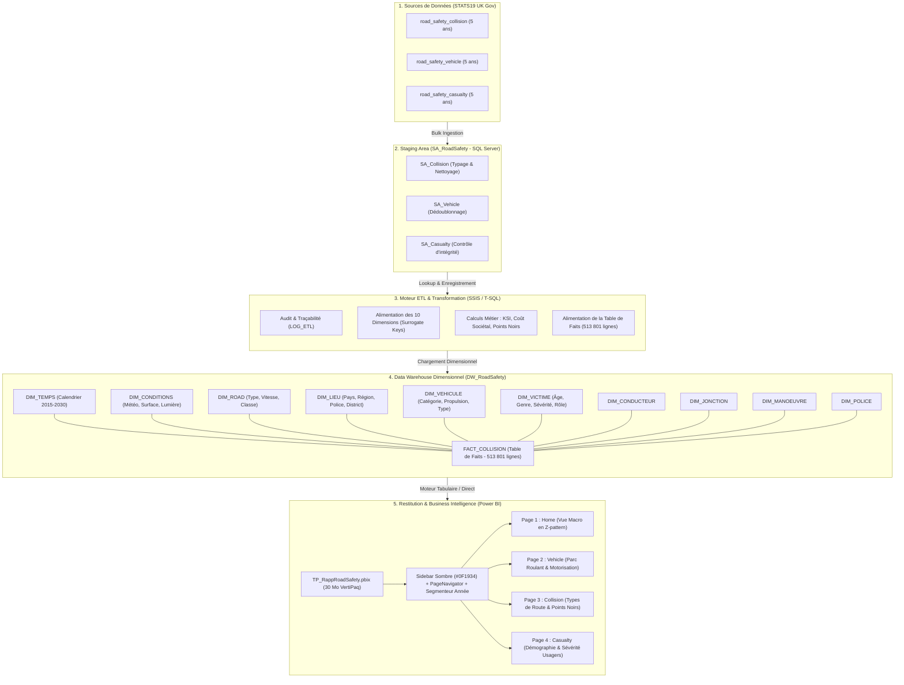

# 🚦 Système Décisionnel pour la Sécurité Routière (UK STATS19)
### Projet Data Warehouse & Business Intelligence – ESPRIT 2026


---

## 📌 Présentation du Projet
Ce projet implémente une solution décisionnelle complète de bout en bout pour l'analyse des accidents de la route au Royaume-Uni (**données ouvertes STATS19** couvrant **5 années complètes : 2021 à 2025**, soit **513 801 collisions réelles** analysées).

L'architecture suit rigoureusement la méthodologie de modélisation dimensionnelle de **Ralph Kimball** :
- **Staging Area (`SA_RoadSafety`)** : Ingestion brute, contrôle de conformité et typage des flux sources.
- **Data Warehouse (`DW_RoadSafety`)** : Modélisation en schéma en étoile pur composé de **10 Dimensions** entourant **1 Table de Faits** (`FACT_COLLISION`).
- **ETL Hybride (SSIS & T-SQL Pushdown)** : Traitement par lots, historisation SCD Type 1, dédoublonnage, génération de clés de substitution (*Surrogate Keys*) et audit des flux.
- **Tableau de Bord Exécutif Power BI (`TP_RappRoadSafety.pbix`)** : Interface décisionnelle multi-pages moderne dotée d'une barre de navigation latérale dynamique, de mesures DAX ministérielles et d'une disposition en **Z-pattern**.

---

## 🏛️ Architecture Globale du Projet



---

## ⭐ Modélisation Dimensionnelle (Schéma en Étoile)

Le modèle dimensionnel est hébergé sur `localhost` dans la base `DW_RoadSafety`.

### 1. Table de Faits : `FACT_COLLISION` (513 801 lignes)
Chaque enregistrement représente un accident de la route unique avec ses métriques associées :
* **Clés étrangères (Surrogate Keys) :** `temps_key`, `condition_key`, `road_key`, `location_key`, `vehicle_type_key`, `casualty_key`, `driver_key`, `junction_key`, `manoeuvre_key`, `police_key`.
* **Mesures Numériques de Faits :**
  * `number_of_vehicles` : Nombre de véhicules impliqués.
  * `number_of_casualties` : Nombre total de victimes.
  * `collision_severity` : Gravité administrative (1 = Mortel, 2 = Grave, 3 = Léger).
  * `cost_societal_gbp` : Coût sociétal calculé selon le barème du *Department for Transport* (DfT UK).
  * `est_ksi` : Indicateur booléen `TRUE` si l'accident est grave ou mortel (*Killed or Seriously Injured*).
  * `score_point_noir` : Score de dangerosité pour l'identification des points noirs routiers.

### 2. Tables de Dimensions (10 Dimensions)
| Dimension | Clé Primaire | Attributs Clés & Hiérarchies |
| :--- | :--- | :--- |
| **`DIM_TEMPS`** | `temps_key` | Date, Année (2021-2025), Trimestre, Mois, Nom Mois, Heure, Indicateurs Nuit / Heure de Pointe / Week-end / Vacances. |
| **`DIM_CONDITIONS`** | `condition_key` | Conditions Météorologiques, État de la Surface de la Chaussée, Conditions de Luminosité, Dangers Particuliers. |
| **`DIM_ROAD`** | `road_key` | Type de Route (Voie unique, Double voie, etc.), Limitation de vitesse (`speed_limit`), Classe de route. |
| **`DIM_LIEU`** | `location_key` | Hiérarchie Géographique : Pays ➔ Région ➔ Police Force ➔ District Local (`local_authority_district`), Milieu Urbain/Rural. |
| **`DIM_VEHICULE`** | `vehicle_type_key` | Catégorie de Véhicule, Type Détaillé, Mode de Propulsion/Carburant (`propulsion_code`), Modèle. |
| **`DIM_VICTIME`** | `casualty_key` | Tranche d'Âge (`age_band_casualty`), Rôle Usager (`casualty_class` : Conducteur, Passager, Piéton), Sexe, Gravité Clinique. |
| **`DIM_CONDUCTEUR`** | `driver_key` | Tranche d'âge, Sexe, Années d'expérience au volant, Type de trajet. |
| **`DIM_JONCTION`** | `junction_key` | Type de croisement, Contrôle de jonction, Présence de passage piéton. |
| **`DIM_MANOEUVRE`** | `manoeuvre_key` | Manœuvre du véhicule, Premier point d'impact, Dérapage/Tonneau. |
| **`DIM_POLICE`** | `police_key` | Présence policière sur les lieux, Force de police responsable. |

---

## 📊 Dashboard Exécutif Power BI (`PowerBI_RoadSafety/TP_RappRoadSafety.pbix`)

Le rapport décisionnel a été élaboré selon les standards graphiques d'un **tableau de bord exécutif ministériel** (Palette Sunset Lavender, Sidebar sombre `#0F1934`, conteneurs de cartes arrondis) :

```text
┌─────────────────┬──────────────────────────────────────────────────────────────────┐
│  ROAD SAFETY UK │  [2021] [2022] [2023] [2024] [2025]        En-tête Segmenteur    │
│  ────────────── │ ──────────────────────────────────────────────────────────────── │
│  ■ Home         │  [ KPI 1: Volume ]   [ KPI 2: Coût £ ]   [ KPI 3: KSI ]  [ Taux% ] │
│  ■ Vehicle      │ ┌──────────────────────────────────────────────────────────────┐ │
│  ■ Collision    │ │   Courbe Mensuelle (Collisions vs Accidents Graves KSI)      │ │
│  ■ Casualty     │ └──────────────────────────────────────────────────────────────┘ │
│                 │ ┌────────────────────────┐  ┌──────────────────────────────────┐ │
│                 │ │ Camembert Météo        │  │ Bilan Ministériel (Indicateur K) │ │
│                 │ └────────────────────────┘  └──────────────────────────────────┘ │
└─────────────────┴──────────────────────────────────────────────────────────────────┘
```

### Architecture des 4 Pages :
1. **Page 1 - `Home` (Synthèse Générale en Z-pattern) :**
   * **Niveau Supérieur :** Segmenteur d'année interactif et 4 cartes KPI principales (Volume Collisions, Coût Global, Total KSI, Taux KSI %).
   * **Niveau Central :** Courbe temporelle mensuelle et camembert de répartition des collisions selon les conditions météo.
   * **Niveau Inférieur :** Tableau de pilotage annuel avec indicateur ministériel `K_Securite` (mise en forme Rouge/Jaune/Vert) et histogramme comparatif.
2. **Page 2 - `Vehicle` (Parc Roulant & Typologie) :**
   * Répartition des collisions par catégorie de véhicule (Voitures, Deux-roues, Poids Lourds, etc.).
   * Typologie des modes de propulsion et énergies (Essence, Diesel, Électrique, Hybride).
   * Évolution temporelle mensuelle et synthèse détaillée par type de véhicule.
3. **Page 3 - `Collision` (Analyse Spatiale & Environnementale) :**
   * Volume par type d'infrastructure routière et limitation de vitesse.
   * Impact de l'état de la surface (Sec, Mouillé, Enneigé, Verglas) et de la luminosité (Plein jour, Nuit éclairée, Nuit noire).
   * Palmarès décisionnel des districts accidentogènes (**Points Noirs**).
4. **Page 4 - `Casualty` (Démographie & Vulnérabilité des Victimes) :**
   * Pyramide et volume des victimes par tranche d'âge.
   * Répartition par typologie d'usagers : Conducteurs, Passagers, Piétons / Usagers vulnérables.
   * Taux de mortalité et de blessures graves selon le genre et le profil clinique.

---

## 📁 Arborescence Complète du Dépôt Git

```text
Projet Data werehouse- DW/
│
├── 📁 Data 5years/                      # Jeux de données sources STATS19 (2021 à 2025)
│   ├── road_safety_casualty-last_5years.csv
│   ├── road_safety_collision-last_5years.csv
│   └── road_safety_vehicle-last_5years.csv
│
├── 📁 SQL_Scripts/                      # Scripts T-SQL & DDL ordonnancés
│   ├── 00_INGEST_CSV_TO_SA.ps1          # Ingestion automatisée CSV vers Staging
│   ├── 01_CREATE_DATABASE_SA_RoadSafety.sql # DDL de la Staging Area
│   ├── 02_CREATE_DATABASE_DW_RoadSafety.sql # DDL du Data Warehouse (Étoile)
│   ├── 03_AUDIT_LOGGING_ETL.sql         # Table de logging & métriques d'exécution
│   ├── 03_GENERATE_DIM_TEMPS_CALENDAR_SSMS.sql # Générateur du calendrier dimensionnel
│   ├── 04_POPULATE_DIRECT_TSQL.sql      # Pipeline de chargement direct haute performance
│   ├── 05_VERIFICATION_ET_KPIS_SSMS.sql # Requêtes de contrôle de cohérence & KPI DAX
│   └── generate_dim_temps.py            # Générateur Python alternatif du calendrier
│
├── 📁 SSIS_RoadSafety/                  # Projet Visual Studio SSDT pour l'ETL SSIS
│   ├── RoadSafety_SSIS.sln              # Solution Visual Studio
│   ├── RoadSafety_SSIS.dtproj           # Projet Integration Services
│   ├── EL_CSV_SA.dtsx                   # Package d'extraction CSV -> Staging Area
│   ├── ETL_SA_DW.dtsx                   # Package de chargement dimensionnel avec Lookups
│   ├── ETL_SA_DW_Distrisys.dtsx         # Variante conforme au pattern Distrisys
│   ├── LocalHost.DW_RoadSafety.conmgr   # Gestionnaire de connexion DW
│   └── LocalHost.SA_RoadSafety.conmgr   # Gestionnaire de connexion SA
│
├── 📁 PowerBI_RoadSafety/               # Fichier de reporting Power BI final
│   └── TP_RappRoadSafety.pbix           # Dashboard exécutif complet (30 Mo, 4 pages, VertiPaq)
│
├── 📁 Docs/                             # Rapports académiques et documentation technique
│   ├── modele_etoile_stats19.png        # Schéma relationnel du modèle en étoile
│   ├── FACT_TABLE_EXPLICATION.md        # Documentation détaillée du pipeline de la table de faits
│   ├── QUESTIONS_REPONSES_VALIDATION_SSIS_PROF.md # Guide de préparation à la soutenance
│   ├── RAPPORT_ETAPES_ETL_SSIS.md       # Synthèse des étapes techniques d'ETL
│   ├── RAPPORT_TP_POWERBI_ROADSAFETY.md # Manuel d'utilisation du rapport Power BI
│   ├── README_ARCHI_DETAIL_SSIS_SSMS_DW.md # Documentation d'architecture approfondie
│   └── README_ETL_SSIS_DW.md            # Guide des flux de transformation
│
├── .gitignore                           # Exclusions Git (fichiers temporaires, caches locaux)
├── Power BI for Everyone - Fork.pbix    # Modèle graphique de référence (UI/UX)
├── PROJECT_HISTORY.md                   # Journal de bord complet des évolutions techniques
├── README.md                            # Documentation principale du projet
└── Run_Pipeline_Automation.ps1          # Script PowerShell d'automatisation globale
```

---

## 🚀 Démarrage Rapide

### 1. Déploiement des Bases de Données (SSMS)
Exécutez dans **SQL Server Management Studio** :
1. `SQL_Scripts/01_CREATE_DATABASE_SA_RoadSafety.sql` (Initialise `SA_RoadSafety`).
2. `SQL_Scripts/02_CREATE_DATABASE_DW_RoadSafety.sql` (Initialise `DW_RoadSafety`).
3. `SQL_Scripts/03_GENERATE_DIM_TEMPS_CALENDAR_SSMS.sql` (Peuple `DIM_TEMPS`).

### 2. Alimentation du Data Warehouse
* **Via SSIS :** Ouvrez `SSIS_RoadSafety/RoadSafety_SSIS.sln` dans Visual Studio et lancez `EL_CSV_SA.dtsx` puis `ETL_SA_DW.dtsx`.
* **Via T-SQL Direct :** Exécutez `SQL_Scripts/04_POPULATE_DIRECT_TSQL.sql` pour un chargement direct optimisé des 513 801 collisions.

### 3. Contrôle & Audit
Exécutez `SQL_Scripts/05_VERIFICATION_ET_KPIS_SSMS.sql` pour valider les volumétries, l'absence d'orphelins et la cohérence des indicateurs DAX.

### 4. Consultation du Tableau de Bord Power BI
Ouvrez directement dans **Power BI Desktop** :  
👉 **`PowerBI_RoadSafety/TP_RappRoadSafety.pbix`**
